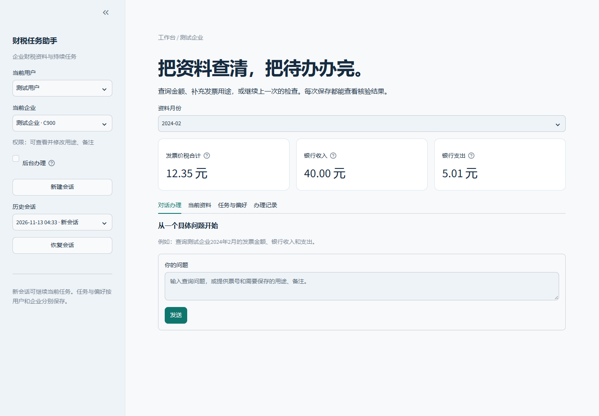
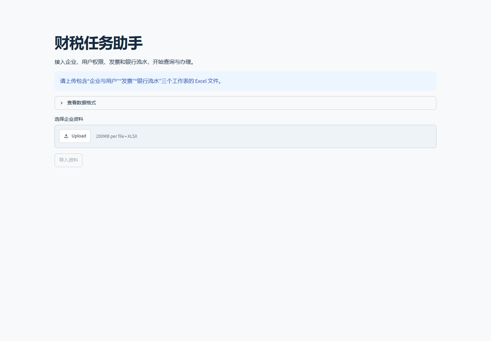
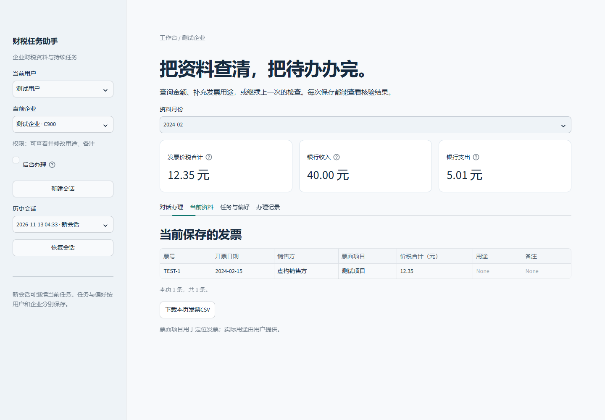
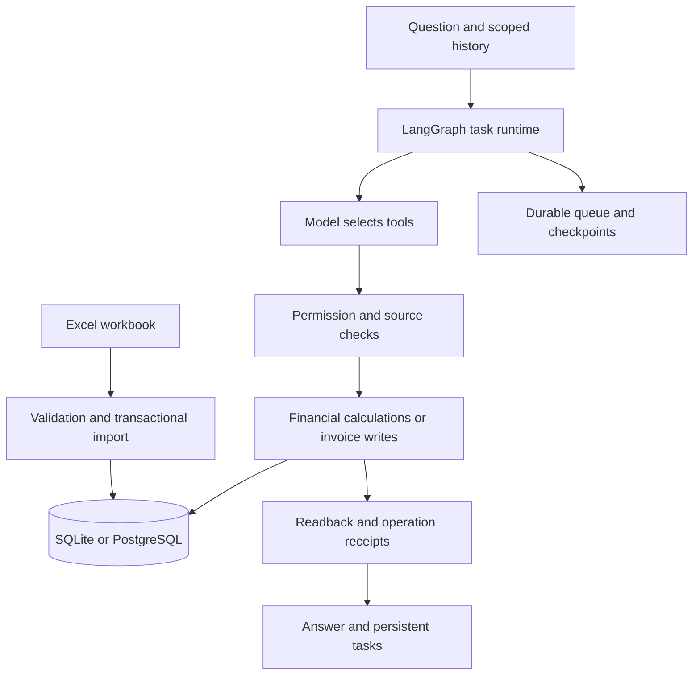

<p align="center"></p>

# Tax Task Agent

**English** | [简体中文](README.zh-CN.md)

**Ask about finances. Save invoice details. Continue unfinished work.**

[Quick start](#quick-start) · [Features](#features) · [Data format](docs/data-format.md) · [Development](docs/development.md) · [Profile](https://github.com/victoryloser)

`Python 3.11` · `Streamlit` · `LangGraph` · `SQLite / PostgreSQL` · [MIT](LICENSE)

A conversational workspace for enterprise invoices and bank transactions. Query monthly totals, update invoice purpose and notes with authorization and readback, and keep tasks and preferences across sessions. Durable jobs and operation receipts support interrupted execution.

## Features

| Feature | Behavior |
|---|---|
| Financial queries | Calculate invoice totals, income and expenses independently using integer cents |
| Controlled writes | Edit invoice purpose and note only; check permissions and row version, then read back |
| Persistent work | Store tasks, preferences and conversation history per user and enterprise |
| Background processing | Queue work, run workers and resume interrupted jobs |
| Versioned rules | Import administrator-reviewed rule drafts and activate explicit versions |
| Data onboarding | Start without bundled data and import a workbook through the UI or CLI |

## Screenshots

These screenshots show the real Chinese UI with temporary fictional records generated by the test helper. They do not use local business data or call a model.



<details>
<summary>First launch and invoice records</summary>





</details>

## Architecture



The model interprets requests and selects tools. Application code calculates totals and enforces write limits. See the [execution and recovery protocol (Chinese)](docs/runtime.md).

## Quick start

Requirements: Python 3.11 and, for conversational requests, a Chat Completions service with native tool calling.

Windows PowerShell, from this directory:

```powershell
python -m venv .venv
.venv/Scripts/python.exe -m pip install -r requirements.lock.txt
.venv/Scripts/python.exe -m pip install --no-deps -e .
Copy-Item .env.example .env
.venv/Scripts/python.exe -m streamlit run tax_agent/ui/app.py
```

Linux / macOS:

```bash
python3.11 -m venv .venv
.venv/bin/python -m pip install -r requirements.lock.txt
.venv/bin/python -m pip install --no-deps -e .
cp .env.example .env
.venv/bin/python -m streamlit run tax_agent/ui/app.py
```

Open http://127.0.0.1:8502. The current UI uses Chinese labels. On first launch, upload your `.xlsx` workbook and select **Import data** (`导入资料`). No data files or model credentials are required to start the interface; import and displayed totals do not call a model.

Configure `.env` before sending conversational requests:

| Setting | Meaning |
|---|---|
| `LLM_BASE_URL` | API base URL, without `/chat/completions` |
| `LLM_API_KEY` | API key |
| `LLM_MODEL` | Model identifier |
| `LLM_TIMEOUT_SECONDS` | Timeout in seconds; default 60 |
| `TAX_AGENT_DATABASE_URL` | Optional PostgreSQL URL; otherwise SQLite |
| `TAX_AGENT_DB` | Optional local database path for the UI |

Business data, source workbooks, historical samples, databases, credentials and logs are excluded from Git and source archives. Runtime databases and checkpoints live in `data/`; logs and execution artifacts live in `runs/`.

## Supported data format

The current importer supports **one `.xlsx` workbook** containing `企业与用户` (enterprises, users and permissions), `发票` (invoices), and `银行流水` (bank transactions). It requires documented headers, types, unique keys and enterprise references. Arbitrary schemas, CSV and legacy `.xls` are not supported.

See the bilingual [data format specification](docs/data-format.md) for the complete schema and permission matrix layout. Import works only on a business-empty database and refuses to overwrite existing data. Excel import does not create purpose-check rules.

Optional CLI setup; use `.venv/bin/python` on Linux/macOS:

```powershell
# Create an empty database, then import into it.
.venv/Scripts/python.exe -m tax_agent.cli init
.venv/Scripts/python.exe -m tax_agent.cli import-data path/to/your-workbook.xlsx

# Alternatively, initialize a new database directly from a workbook.
.venv/Scripts/python.exe -m tax_agent.cli --db data/another.sqlite3 init --source path/to/your-workbook.xlsx
```

## Usage and current limits

Select an imported user and enterprise, then ask a question with a year and month. For example: “Query invoice totals, bank income and bank expenses for September 2026.” To edit a record, state its invoice ID and the exact purpose or note to save.

Only **purpose and note** can be modified. Amounts, dates and bank transactions remain read-only. Batch edits commit per invoice; they do not provide all-or-nothing batch transactions. Results distinguish saved, failed, unverified and incomplete items.

Purpose-completeness checks currently support **September 2026 only**, with applicable administrator-reviewed rules. Other months support totals and explicitly authorized edits. Rules support information, all invoices, and amount thresholds; arbitrary natural-language rule compilation is not supported.

The user selector is a local identity switcher, not authentication. Internet-facing deployment requires real authentication and trusted session identities. This is an engineering project for defined bookkeeping workflows, not a complete tax filing system.

## Background jobs

Start a worker before using **Background processing** (`后台办理`) in the UI:

```powershell
.venv/Scripts/python.exe -m tax_agent.cli worker --workers 2
.venv/Scripts/python.exe -m tax_agent.cli enqueue "查询2026年9月三项金额" --user YOUR_USER_ID --enterprise YOUR_ENTERPRISE_ID
.venv/Scripts/python.exe -m tax_agent.cli jobs --user YOUR_USER_ID --enterprise YOUR_ENTERPRISE_ID
.venv/Scripts/python.exe -m tax_agent.cli chat --user YOUR_USER_ID --enterprise YOUR_ENTERPRISE_ID
```

Replace identity arguments with IDs from your workbook. Work in one user/enterprise scope is serialized; other scopes can run concurrently. SQLite workers require the same host. PostgreSQL deployment, migration, rule management and service installation are documented in the [development guide (Chinese)](docs/development.md).

## Checks and source packaging

```powershell
.venv/Scripts/python.exe -m pytest -q
.venv/Scripts/python.exe -m pip check
.venv/Scripts/python.exe -m tax_agent.cli doctor
.venv/Scripts/python.exe scripts/build_release.py
.venv/Scripts/python.exe scripts/check_archive.py
```

Offline onboarding tests generate tiny fictional records in temporary directories. Historical regressions explicitly skip when their local Excel/Word files are absent. PostgreSQL and live-model tests are separate optional checks; see the development guide.

[GitHub Actions](.github/workflows/ci.yml) installs locked dependencies, runs offline tests and checks source archives on Windows and Ubuntu with Python 3.11. It needs no business data or API keys. `scripts/verify_release.py` additionally installs the archive into a temporary environment and checks data-free startup, tests and Streamlit health.

## Project structure

| Directory | Purpose |
|---|---|
| `tax_agent/` | Domain logic, tool calls, context, storage, runtime and UI |
| `tests/`, `integration/` | Offline and optional PostgreSQL tests |
| `docs/` | Schema, architecture, development and recovery protocol |
| `scripts/`, `deploy/` | Packaging, service tools and PostgreSQL deployment |
| `material/` | Optional local historical samples; excluded |
| `data/`, `runs/` | Local runtime data and logs; excluded |

## License

[MIT](LICENSE). Third-party dependencies retain their own licenses.
