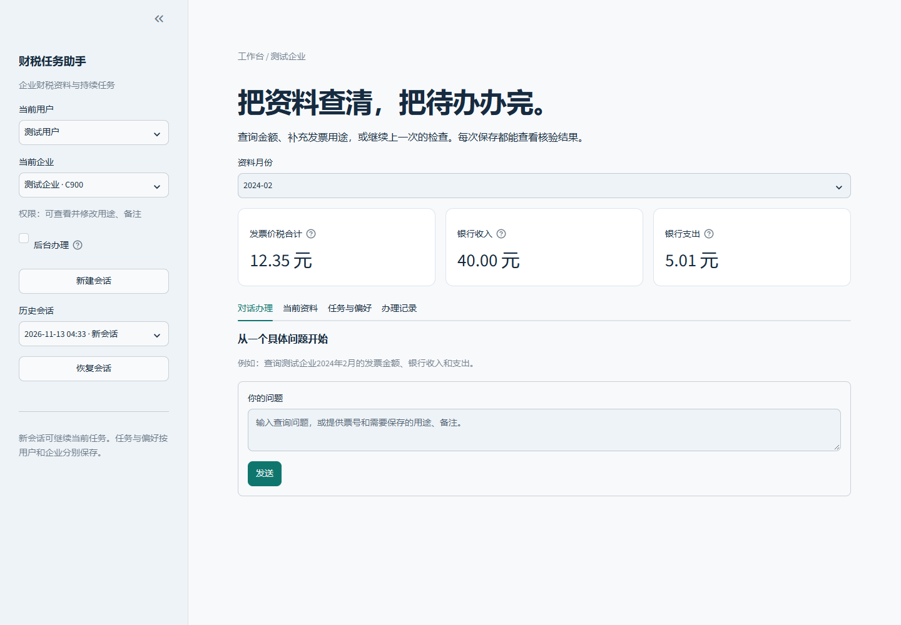
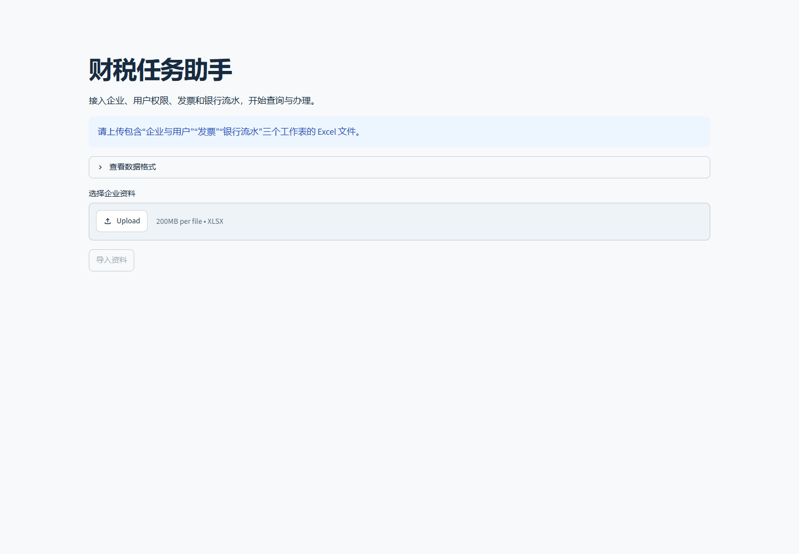
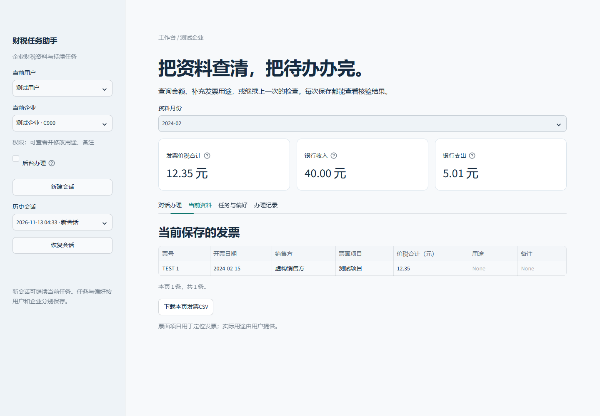

<p align="center"></p>

# 财税任务助手

[English](README.md) | **简体中文**

**查清收支，保存发票信息，接着完成未办事项。**

[快速开始](#安装与启动) · [数据格式](docs/data-format.md) · [开发文档](docs/development.md) · [GitHub 主页](https://github.com/victoryloser)

`Python 3.11` · `Streamlit` · `LangGraph` · `SQLite / PostgreSQL` · [MIT](LICENSE)

以对话方式查询企业收支、维护发票用途与备注、检查资料缺失，并持续跟踪未完成任务。支持跨会话任务、用户偏好、版本化规则、后台队列和中断恢复。

## 界面预览

截图使用临时生成的少量虚构记录，展示实际中文界面，不读取本地业务数据，也不调用模型。



<details>
<summary>首次启动与发票资料</summary>





</details>

## 环境要求

- Python 3.11
- 支持 Chat Completions 原生工具调用的模型服务
- SQLite；多主机运行可使用 PostgreSQL

## 安装与启动

在项目目录执行：

```powershell
python -m venv .venv
.venv/Scripts/python.exe -m pip install -r requirements.lock.txt
.venv/Scripts/python.exe -m pip install --no-deps -e .
Copy-Item .env.example .env
```

配置 .env：

| 配置 | 含义 |
|---|---|
| LLM_BASE_URL | 模型接口地址，不包含 /chat/completions |
| LLM_API_KEY | API 密钥 |
| LLM_MODEL | 模型标识 |
| LLM_TIMEOUT_SECONDS | 请求超时，默认 60 秒 |
| TAX_AGENT_DATABASE_URL | PostgreSQL 连接地址；未配置时使用 SQLite |

启动界面：

```powershell
$env:PYTHONUTF8='1'
.venv/Scripts/python.exe -m streamlit run tax_agent/ui/app.py
```

浏览器访问 http://127.0.0.1:8502 。首次启动上传自己的 Excel 并点击“导入资料”；无需预置数据或模型密钥即可打开界面，导入和首页金额展示不调用模型。发送对话前配置模型服务。已有数据库可直接启动；更新表结构使用 `python -m tax_agent.cli migrate`。

Linux/macOS：

```bash
python3.11 -m venv .venv
.venv/bin/python -m pip install -r requirements.lock.txt
.venv/bin/python -m pip install --no-deps -e .
cp .env.example .env
PYTHONUTF8=1 .venv/bin/python -m streamlit run tax_agent/ui/app.py
```

业务数据、原始工作簿、历史样例、数据库、密钥和日志不会进入 Git 或源码压缩包，本地已有文件保留。业务库与检查点保存在 `data/`，运行记录与日志保存在 `runs/`。界面可使用 `TAX_AGENT_DB` 指定其他本地数据库。

## 当前支持的数据格式

支持一个 `.xlsx` 工作簿，包含 `企业与用户`、`发票`、`银行流水` 三个工作表，须满足规定的表头、字段类型、唯一键与企业关联。当前不支持任意表结构、CSV 或旧版 `.xls`。

完整字段与权限表布局见 [中英文数据格式说明](docs/data-format.md)。导入仅限空业务库，不能覆盖已有企业、会话或业务记录；Excel 导入不会自动创建用途检查规则。

```powershell
# 创建空库后再导入。
.venv/Scripts/python.exe -m tax_agent.cli init
.venv/Scripts/python.exe -m tax_agent.cli import-data path/to/your-workbook.xlsx

# 或者直接以工作簿初始化一个新库。
.venv/Scripts/python.exe -m tax_agent.cli --db data/another.sqlite3 init --source path/to/your-workbook.xlsx
```

## 使用

侧边栏选择用户和企业后，可以输入：

- “查询 2026 年 9 月的发票金额、银行收入和支出。”
- “检查哪些发票缺用途，建立待办任务。”
- “将 F002 的用途改为客户会议资料印刷，并查回核实。”
- “继续处理之前未完成的任务。”
- “以后查询金额时优先用表格展示，请长期记住。”

发票修改仅支持用途与备注，金额、日期及流水保持只读。每次写入检查用户授权和行版本，保存后独立查回。批量修改逐票提交，回执列出成功、失败、待核实及待补充项。

用户、企业、权限与月份从导入资料读取。任务及偏好按用户和企业隔离。界面用户选择器用于本地身份切换，并非登录认证；对外部署须接入真实认证与受信身份。项目面向财务资料处理流程，不包含完整报税系统。

用途缺失检查目前只支持 **2026 年 9 月**，且须有适用的已审核规则；其他月份支持金额查询及明确授权的用途、备注修改。规则支持信息说明、全部发票、金额门槛三类条件，不自动编译任意自然语言规则。管理员规则操作见 [开发文档](docs/development.md)。

## 后台任务

启动 worker：

```powershell
.venv/Scripts/python.exe -m tax_agent.cli worker --workers 2
```

启动 worker 后，网页选择“后台办理”，任务入队执行；刷新页面可查看结果。命令行也可提交和查询，将 YOUR_USER_ID、YOUR_ENTERPRISE_ID 替换为导入的实际编号：

```powershell
.venv/Scripts/python.exe -m tax_agent.cli enqueue "查询2026年9月三项金额" --user YOUR_USER_ID --enterprise YOUR_ENTERPRISE_ID
.venv/Scripts/python.exe -m tax_agent.cli jobs --user YOUR_USER_ID --enterprise YOUR_ENTERPRISE_ID
.venv/Scripts/python.exe -m tax_agent.cli chat --user YOUR_USER_ID --enterprise YOUR_ENTERPRISE_ID
```

同一用户和企业的任务按顺序执行，不同范围可以并行。重启 worker 会接续持久化任务，已提交的数据库修改通过操作台账核实。SQLite worker 仅支持同机运行；PostgreSQL、多机部署、迁移与服务安装见开发文档。批量保存逐票提交，不支持整批全成全败。

## 项目结构

| 目录 | 职责 |
|---|---|
| tax_agent/ | 领域逻辑、模型工具、上下文和运行时 |
| tests/、integration/ | 单元测试和 PostgreSQL 集成测试 |
| material/ | 可选本地历史样例，不发布 |
| deploy/ | PostgreSQL 部署配置 |
| scripts/ | 服务安装和开发工具 |
| docs/ | 架构、恢复协议和运维说明 |
| data/ | 业务库和 checkpoint |
| runs/ | 执行记录和服务日志 |

## 测试

```powershell
.venv/Scripts/python.exe -m pytest -q
.venv/Scripts/python.exe -m pip check
.venv/Scripts/python.exe -m tax_agent.cli doctor
.venv/Scripts/python.exe scripts/build_release.py
.venv/Scripts/python.exe scripts/check_archive.py
```

离线接入测试在临时目录生成少量虚构记录。历史样例回归在本地 Excel/Word 缺失时明确跳过，不要求发布样例文件。PostgreSQL 和真实模型测试需要单独配置，详见 [开发文档](docs/development.md)。

[GitHub Actions](.github/workflows/ci.yml) 使用 Python 3.11，在 Windows 和 Ubuntu 安装锁定依赖、运行离线测试并检查源码包，不需要业务数据与 API 密钥。`scripts/verify_release.py` 可进一步在临时环境安装源码包，检查无数据初始化、测试与 Streamlit 健康状态。

## 许可证

[MIT](LICENSE)。第三方依赖遵循各自的许可证。
